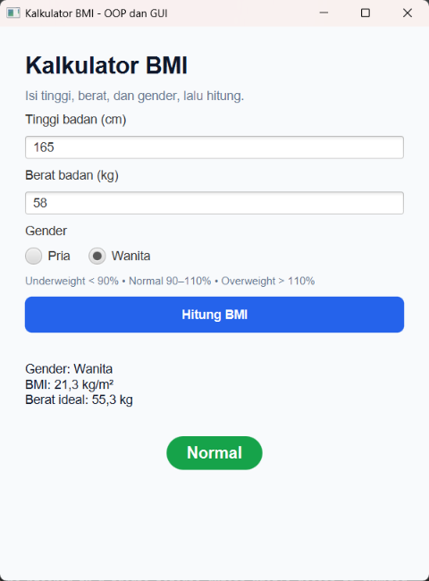
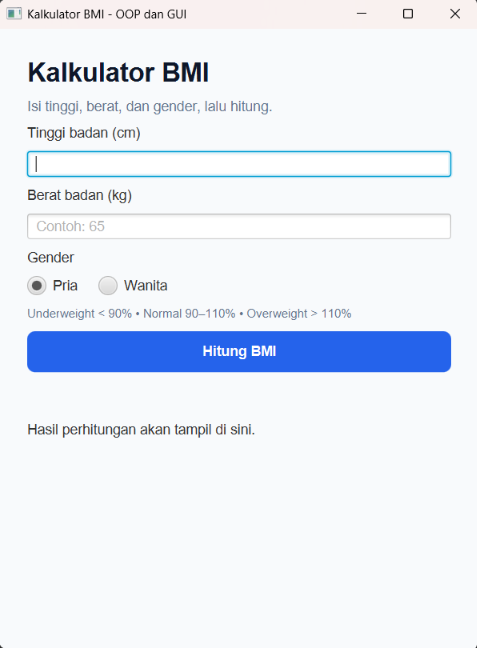

# BMIApp

Aplikasi kalkulator BMI (Body Mass Index) berbasis JavaFX SceneBuilder (FXML) dan Maven. Memiliki perhitungan yang berbeda untuk pria dan wanita,
dengan output berat badan ideal dan kategori (Underweight, Normal, Overweight). Proyek ini dibuat untuk memenuhi tugas mata kuliah Pemrograman Lanjut dengan menerapkan prinsip Object-Oriented Programming (OOP) dan pola arsitektur MVC (Model-View-Controller).

## Fitur Utama

- **Perhitungan BMI Tanpa Input Nama**: Pengguna cukup memasukkan tinggi badan (cm), berat badan (kg), dan memilih jenis kelamin lewat radio button. Aplikasi menampilkan nilai BMI dengan rumus $BMI = \frac{Berat\ (kg)}{(Tinggi\ (m))^2}$ sebagai informasi tambahan.
- **Perhitungan Persentase Berbeda untuk Pria dan Wanita (Polimorfisme)**: Aplikasi menghitung persentase berat badan terhadap berat ideal menurut rumus Broca. `BmiPria` mengurangi 10% dari `tinggi - 100`, sedangkan `BmiWanita` mengurangi 15%.
  - Pria: berat ideal = (tinggi - 100) × 0,90
  - Wanita: berat ideal = (tinggi - 100) × 0,85
  - Persentase = berat badan ÷ berat ideal × 100
- **Tampilan Hasil Berwarna**: Kategori ditampilkan dalam badge berwarna, yaitu kuning untuk Underweight, hijau untuk Normal, dan merah untuk Overweight. Hasil juga memuat gender, nilai BMI, berat ideal, dan persentase.
- **Validasi Input & Penanganan Eksepsi**: Aplikasi memvalidasi input kosong atau format non-angka (`NumberFormatException`), serta nilai di luar batas wajar, yaitu tinggi 100–250 cm dan berat 20–300 kg (`IllegalArgumentException`), dengan pesan peringatan berwarna merah pada antarmuka. Koma desimal seperti `65,5` juga diterima.
- **Mode Terminal & GUI**: Menyediakan kelas `MainApp` untuk tampilan antarmuka grafis (JavaFX) dan `DemoTerminalMode` untuk pengujian cepat melalui konsol/terminal.

## Kebutuhan Sistem
- JDK 17 atau lebih baru
- Apache Maven (sudah terintegrasi di NetBeans / IntelliJ / Eclipse)
- JavaFX SceneBuilder

## Cara Menjalankan
1. Clone repository:
   ```
   git clone https://github.com/chaavier/BMIApp.git
   ```
2. Buka NetBeans, pilih File > Open Project, lalu pilih folder `BmiApp`.
3. Klik kanan project, pilih Run (atau tekan F6).
4. Atau lewat terminal: `mvn clean javafx:run`

## Rumus
- Pria: berat ideal = (tinggi - 100) x 0,90
- Wanita: berat ideal = (tinggi - 100) x 0,85
- Underweight < 90%, Normal 90-110%, Overweight > 110%

## Screenshot



## Struktur Project
- `model/` : kelas Bmi, BmiPria, BmiWanita
- `controller/` : BmiController
- `main/` : MainApp
- `resources/form-bmi.fxml` : tampilan GUI
